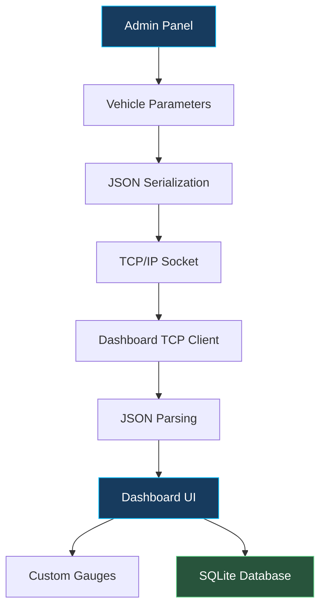

<div align="center">

# 🚘 AutoPulse
### Automotive Dashboard Simulator

**A Real-Time Vehicle Dashboard Built with C++ & Qt**

Simulating vehicle telemetry with custom digital gauges, TCP/IP communication, and persistent data logging.

<br/>


<br/><br/>


<br/>

*Visualizing vehicle data. Connecting automotive interfaces. Built for the desktop.*

</div>

---

## 📌 Overview

**AutoPulse** is a desktop-based Automotive Dashboard Simulator developed using **C++14, Qt Widgets, and SQLite**. It simulates essential vehicle parameters through a graphical dashboard and allows an independent Admin Panel to control vehicle data over a TCP/IP connection.

The project demonstrates Qt GUI development, custom-painted widgets, network communication, JSON-based data exchange, and database integration.

## ✨ Key Features

<table>
<tr>
<td width="50%" valign="top">

### 🏎️ Digital Speedometer
Displays simulated vehicle speed through a custom-painted gauge.

</td>
<td width="50%" valign="top">

### ⚙️ RPM Gauge
Visualizes engine RPM with a dynamic tachometer-style indicator.

</td>
</tr>
<tr>
<td width="50%" valign="top">

### ⛽ Fuel Indicator
Displays fuel level using a segmented visual indicator.

</td>
<td width="50%" valign="top">

### 🔢 Gear Display
Represents reverse, neutral, and forward gear states.

</td>
</tr>
<tr>
<td width="50%" valign="top">

### 🌐 TCP/IP Communication
Connects the dashboard to a separate Admin Panel using Qt networking classes.

</td>
<td width="50%" valign="top">

### 🗄️ SQLite Logging
Stores dashboard telemetry, including speed, RPM, gear, and fuel, in a local database.

</td>
</tr>
</table>

## 🖥️ Dashboard Interface


<div align="center">

| Main Dashboard | Admin Panel |
|:---:|:---:|
|
| 
 |

</div>

Replace the placeholders with your screenshots:

```html


```

## 🏗️ System Architecture

AutoPulse consists of two independent Qt applications that communicate over a TCP/IP connection.



### 🔄 Data Flow

1. The Admin Panel lets the user adjust simulated vehicle parameters.
2. The application serializes the values into compact JSON.
3. The JSON payload is sent through a TCP socket, terminated by a newline.
4. The dashboard buffers incoming bytes and processes complete lines.
5. Parsed values update the dashboard gauges and indicators.
6. Dashboard telemetry is logged in the SQLite database.

**Example JSON payload:**

```json
{"speed":80,"rpm":3200,"gear":3,"fuel":75}
```

## 🧰 Technology Stack

| Technology | Application |
|---|---|
| C++14 | Application logic and object-oriented design |
| Qt Widgets | Desktop graphical interface |
| Qt Network | TCP client-server communication |
| QTcpSocket | Dashboard network client |
| QTcpServer | Admin Panel server |
| QJsonDocument / QJsonObject | JSON serialization and parsing |
| QPainter | Custom gauge rendering |
| QTimer | Periodic dashboard updates and clock |
| Qt SQL / SQLite | Persistent telemetry logging |
| GoogleTest | Unit testing of selected components |

## 🧩 Project Structure

```text
AutoPulse/
│
├── Dashboard/
│   ├── main.cpp
│   ├── mainwindow.h
│   ├── mainwindow.cpp
│   ├── dataclient.h
│   ├── dataclient.cpp
│   ├── databasemanager.h
│   ├── databasemanager.cpp
│   ├── gaugewidget.h
│   ├── gaugewidget.cpp
│   ├── fuelwidget.h
│   ├── fuelwidget.cpp
│   ├── gearwidget.h
│   ├── gearwidget.cpp
│   └── simulationlogic.h
│
├── AdminPanel/
│   ├── main.cpp
│   ├── mainwindow.h
│   └── mainwindow.cpp
│
├── tests/
├── assets/
└── README.md
```

*Adjust the directory tree to match the actual files in your repository.*

## ⚙️ Getting Started

### Prerequisites

- Qt development environment with the required Qt modules
- Qt Creator IDE
- C++14-compatible compiler
- Qt Widgets, Qt Network, and Qt SQL modules
- SQLite driver available in your Qt installation

### Installation

**1. Clone the repository**

```bash
git clone https://github.com/pratik8815/AutoPulse.git
cd AutoPulse
```

**2. Open the project**

Open the Dashboard and Admin Panel project files in Qt Creator.

**3. Configure the build**

Select a compatible compiler and Qt kit. Build both applications separately.

**4. Launch the applications**

- Start the Admin Panel and start its TCP server.
- Launch the Dashboard application.
- Ensure both applications use the same TCP port and compatible connection settings.

**5. Test communication**

Adjust speed, gear, and fuel values in the Admin Panel and observe the corresponding dashboard updates.

> Ensure that the server is listening before the dashboard attempts to connect. Update the repository URL and build instructions if your project uses different paths or configuration.

## 🧪 Testing

Unit tests can help validate individual application components independently.

The project includes tests for selected components such as:

- DatabaseManager
- DataClient
- GaugeWidget
- GearWidget

GoogleTest can be used to run the configured test suite. Verify the test target and build configuration in your repository before relying on these tests.

## 💡 Engineering Concepts Demonstrated

- Object-Oriented Programming with C++14
- Qt Signals and Slots
- Custom widget rendering with QPainter
- TCP client-server architecture
- JSON-based data exchange
- Network stream buffering and message framing
- SQLite database operations
- Separation of UI, networking, and database logic
- Unit testing of selected components

## 🚀 Future Enhancements

- Connect to real vehicle data through a CAN interface.
- Add diagnostic trouble code (DTC) visualization.
- Implement connection recovery and network error handling.
- Add historical telemetry charts and export functionality.
- Improve dashboard themes and responsive layouts.
- Expand automated test coverage.

## 👨‍💻 Author

**Pratik Satsure**

<a href="https://github.com/pratik8815">
  
</a>
<a href="https://www.linkedin.com/in/pratik42/">
  
</a>

---

<div align="center">

### Built with C++14 & Qt

*An automotive software simulation project exploring connected dashboard interfaces.*

</div>
